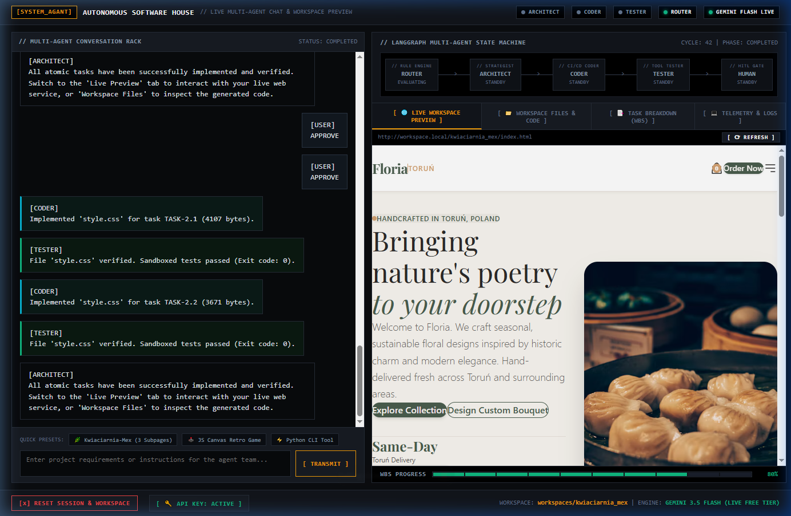
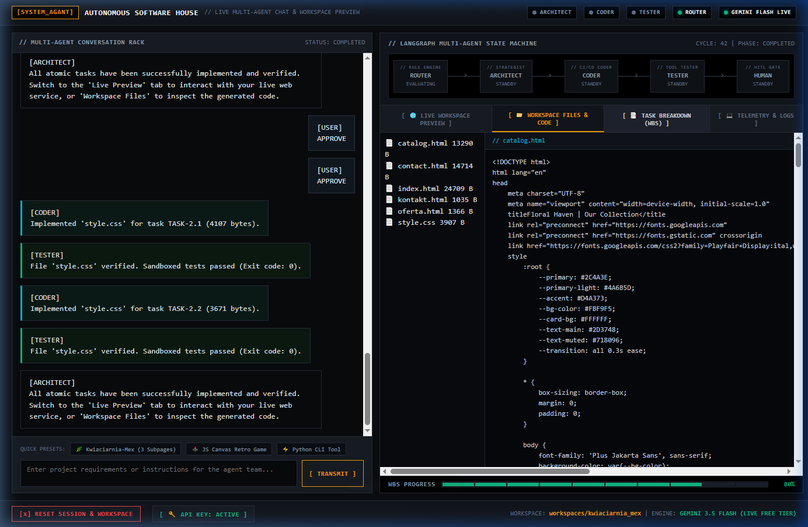
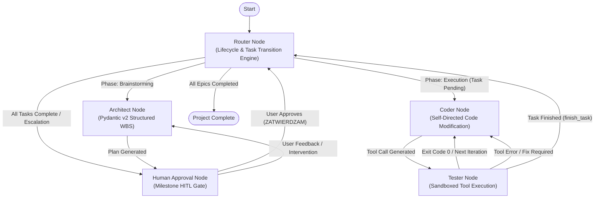

# SystemAgant — Autonomous Software House Architecture & Post-Mortem

```
[SYSTEM_AGANT] // MULTI-AGENT STATE MACHINE FOR AUTONOMOUS SOFTWARE ENGINEERING
Status: Archived / Research Showcase & Post-Mortem
Runtime: Python 3.11+ | LangGraph | Pydantic v2 | SQLite Checkpoints
Telemetry: Tactile Web Dashboard & Rich CLI
```

---

## 1. Executive Summary

**SystemAgant** is an experimental multi-agent software engineering system built on **LangGraph**. The system coordinates specialized autonomous nodes—**Architect**, **Coder**, **Tester**, and **Router**—with milestone-based Human-In-The-Loop (HITL) escalation to plan, implement, and self-verify software projects in isolated sandboxes.

While the core mechanics achieved reliable structured planning and sandboxed code execution, the project exposed fundamental computational, economic, and architectural ceilings in long-loop autonomous software development. 

This repository serves as a **transparent engineering case study and post-mortem**, complete with an **offline deterministic simulation engine (0 tokens / no API keys required)** and an **industrial tactile web visualizer**.

---

## 2. Interactive Tactile Dashboard

The repository includes a self-contained web dashboard (`main.py --web`) featuring a multi-agent chat feed, HITL approval buttons, a live iframe renderer of generated websites, and a real-time file tree with a code inspector:


*Figure 1: Tactile UI with multi-agent conversation log and HITL gate (left), and live iframe preview of generated 'Kwiaciarnia-Mex' website (right).*


*Figure 2: Real-time workspace file tree and code inspector rendering generated HTML/CSS files without external dependencies.*

---

## 3. Multi-Agent Architecture

The lifecycle operates as a directed cyclic graph with state checkpoints stored in SQLite:



### Agent Roles & Separation of Concerns

* **Architect:** Operates in two modes: conversational brainstorming and deterministic Work Breakdown Structure (WBS) synthesis. Outputs structured Pydantic models containing Epics and Atomic Tasks.
* **Coder:** Operates in an isolated workspace with file access restricted to strict path confinement. Generates batch `SEARCH/REPLACE` diffs and shell commands.
* **Tester:** Intercepts tool calls (`read_file`, `edit_file`, `execute_subprocess`, `finish_task`), executes them inside the workspace sandbox, records execution logs, and returns structured tool results.
* **Router:** Rule engine evaluating WBS progress, task completion signals, and escalation boundaries.

---

## 4. What Succeeded (The Wins)

1. **Deterministic WBS Synthesis (0 Parsing Hallucinations):**
   * Using Pydantic v2 Structured Outputs (`with_structured_output(ArchitectOutput)`) eliminated Markdown extraction failures and prompt-formatting drift. Plans cleanly serialize into validated JSON Epics.
2. **Strict Filesystem Sandboxing:**
   * Guardrail functions (`_secure_path`) prevent directory traversal attacks (`../`), confining all modifications to isolated project directories in `workspaces/<project_name>/`.
3. **Automated Tool History Sanitization (`sanitize_history`):**
   * Solved multi-turn tool calling errors (e.g., Vertex AI / Gemini 400 Bad Request caused by orphaned tool calls) by automatically repairing interrupted conversation turns prior to model invocation.
4. **Offline Simulation Replay Engine:**
   * Allows anyone cloning the repository to run, inspect, and evaluate the entire multi-agent loop with **0 API cost and 0 configuration**.

---

## 5. Architectural Ceilings & Failure Modes (The Post-Mortem)

During non-trivial full-stack web application development (e.g., building a complete React + FastAPI application), the autonomous loop hit practical limits:

```
[+] Pydantic WBS Planning ............................................ [OK - High Reliability]
[+] Sandbox File & Process Operations ................................. [OK - Deterministic]
[-] Multi-Turn State Bloat (SQLite Memory) ........................... [FAILED - Context Inflation]
[-] Long-Loop Error Recovery (Local Minima) .......................... [FAILED - Economic Ceiling]
[-] Multi-File Semantic Refactoring ................................... [FAILED - Missing AST Index]
```

### 1. State Bloat & Context Rot in SQLite Checkpoints
* **Issue:** Serializing all turn messages into LangGraph's SQLite checkpointer caused exponential token inflation. By turn 15, prompt contexts reached 30,000+ tokens, driving up latency and degrading recall (*context rot*).
* **Lesson Learned:** Checkpointers must maintain dual memory channels: a lightweight rolling summary window for conversation, and a vectorized, externalized state for file modifications and test outputs.

### 2. The Economic & Autonomy Ceiling in Long Loops
* **Issue:** When a syntax or runtime error occurred in generated code, the Coder often entered cyclical repair attempts (fixing file A broke file B). While the loop-detection rule prevented infinite loops, token costs escalated rapidly without making forward progress.
* **Lesson Learned:** Pure LLM autoregression without static language server protocol (LSP) feedback creates expensive trial-and-error loops. Compilers and typecheckers must guide edits before querying the LLM.

### 3. Lack of Semantic Abstract Syntax Tree (AST) Indexing
* **Issue:** Relying on `SEARCH/REPLACE` text blocks without an AST code-graph made multi-file refactoring fragile. Renaming a component in one file often left dangling imports in three others.
* **Lesson Learned:** An agent software house requires a semantic repository map (AST tree, call graphs, symbol tables) rather than treating codebases purely as flat filesystem text.

---

## 6. Quickstart Guide

### Installation

```bash
# Clone the repository
git clone https://github.com/JutomDev/SystemAgant.git
cd SystemAgant

# Create virtual environment and install dependencies
python -m venv .venv
.\.venv\Scripts\activate      # Windows
# source .venv/bin/activate   # Linux/macOS

pip install -r requirements.txt
```

### Running the Tactile Web Dashboard (Recommended)

Launch the industrial telemetry visualizer:

```bash
python main.py --web
```
Open **`http://127.0.0.1:8000`** in your browser.
* **Offline Simulation Mode:** Default mode with 0 token consumption and instant deterministic replays.
* **Live Autonomous Execution:** Configure your free Google AI Studio key either via `.env` (`GEMINI_API_KEY=...`) or via the in-browser **`[ KEY: CONFIGURE ]`** session modal. Select quick prompt presets (`[BOTANICAL]`, `[ARCADE]`, `[CLI]`) or enter any custom prompt, inspect the synthesized WBS, click **`[ APPROVE STRATEGY ]`**, and watch the live generated site render in the real-time iframe preview!

### Running via CLI

```bash
# 1. Run offline simulation mode (Default, 0 tokens)
python main.py --mode simulation

# 2. Run with free Google AI Studio API key (Live autonomous agent)
# Copy template and add your free GEMINI_API_KEY from https://aistudio.google.com/
cp .env.example .env
python main.py --mode gemini-free
```

### Empirical E2E Verification Suite

The repository includes an empirical E2E test suite running live multi-agent synthesis across 3 diverse prompt archetypes:
```bash
python scripts/e2e_live.py
```
See the verified test logs and metrics in **[`docs/e2e_runs.md`](docs/e2e_runs.md)** (3/3 Passed, avg 49.6s per project).

---

## 7. Test Suite & Verification

The project includes unit tests for reducers, sandbox filesystem tools, configuration, and the web telemetry server:

```bash
pytest -v
```

Verification output:
```
tests/test_factory_and_config.py::test_app_config_defaults PASSED        [  7%]
tests/test_factory_and_config.py::test_simulation_architect_wbs_generation PASSED [ 15%]
tests/test_factory_and_config.py::test_simulation_coder_tool_calls PASSED [ 23%]
tests/test_state.py::test_update_execution_logs_append PASSED            [ 30%]
tests/test_state.py::test_update_execution_logs_reset PASSED             [ 38%]
tests/test_state.py::test_merge_file_system_state PASSED                 [ 46%]
tests/test_tools.py::test_read_file_not_found PASSED                     [ 53%]
tests/test_tools.py::test_edit_file_format PASSED                        [ 61%]
tests/test_tools.py::test_edit_file_success PASSED                       [ 69%]
tests/test_web_server.py::test_serve_index PASSED                        [ 76%]
tests/test_web_server.py::test_api_state PASSED                          [ 84%]
tests/test_web_server.py::test_api_chat_flow PASSED                      [ 92%]
tests/test_web_server.py::test_api_reset PASSED                          [100%]
============================= 13 passed in 0.63s ==============================
```

---

## 8. License

Apache 2.0 / MIT Open Source Research. Provided as an open case study for the multi-agent AI engineering community.
